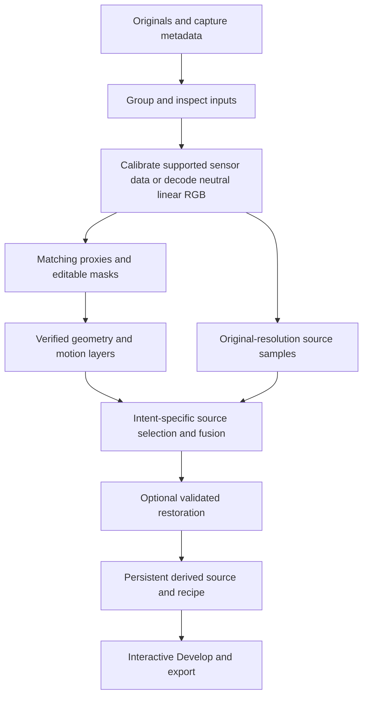

# Proposed architecture and evaluation plan

Date: **2026-10-28**. This document describes future engineering work. It does not introduce types, alter the catalog, run benchmarks, or change the current rendering pipeline.

## Architecture: one source group, explicit photographic intent

The shared primitive should be a **derived image recipe** with several inputs, not a panorama-only list of files or a sequence of destructive filters. A recipe identifies what should remain fixed, what should move, which sources may contribute, and how their measurements are combined.

The [2026-10-29 astro scenario design](astro-scenario-tools.md) specializes this into Star Trails, Night Sky Denoise and Meteor Shower. The [sequence-quality stage](sequence-quality-and-exposure.md) adds per-frame/per-region/per-role decisions, exposure recovery versus night/day segmentation, uncertain timing, and CV/ML quality evidence. Preserve camera motion separately from celestial motion, and allow a frame to contribute to geometry/background while skipping event-detail work.

The [star-motion and focus-stacking expansion](star-motion-and-focus-stacking.md) specifies two dedicated geometry solvers: temporal celestial motion with independent ground alignment, and focus-dependent framing/breathing correction. Within-exposure star-trail deblurring is a separate inverse problem and must not be represented as ordinary registration.

This is a conceptual dependency graph. Restoration order is workflow-specific: sensor defects precede warping; a Bayer denoiser requires the original mosaic; an astro stack can use a calibrated robust average before optional residual restoration. Do not force all workflows through the same denoising stage.

### Proposed recipe fields

| Concern | Information to persist |
| --- | --- |
| Inputs | Original catalog IDs, content identity/hash, capture metadata, per-frame role, inclusion state, panel/bracket membership |
| Intent | Panorama, stars, temporal blur, trails, HDR, focus, or multiframe detail; user-selected motion policy per region |
| Reference | Reference capture, sky epoch if applicable, projection, output orientation, lens/calibration versions |
| Geometry | Pairwise evidence and confidence, global camera solution, layer transforms, accepted local warps, valid coverage |
| Photometry | Black/white levels, color transform, white-balance convention, exposure factors, overlap corrections, saturation and variance information |
| User decisions | Editable masks, source-paint strokes, protected detail, transient choices, frame exclusions, crop |
| Computation | Algorithm/model identifiers, checkpoint/conversion hashes, parameter values, random seeds where relevant, precision/backend |
| Result | Derived file identity, output color/range contract, provenance, effective contribution map, warnings requiring review |

For these two workflows, additionally persist star-track evidence and exposure integration intervals; any accepted blur-kernel/reconstruction parameters; per-frame breathing transforms; focus-confidence/source-index maps; and valid crop coverage. Keep transforms consistent across preview, fusion variants, and source painting.

Star timing records must retain original EXIF values, fractional precision, recorded timezone offset, exposure duration, interpreted start/mid/end times, the assumed camera timestamp convention, and uncertainty. Persist the fitted celestial axis, reference epoch, camera-motion corrections, and timing-versus-track residuals. Use this timeline as a strong shared motion constraint when reliable, with image-only registration as a fallback; see the [detailed EXIF motion model](star-motion-and-focus-stacking.md#exif-time-as-the-backbone-of-the-motion-model).

The recipe belongs in the catalog's existing persistence/history design; this research does not prescribe a schema migration. Small metadata can follow existing sync semantics. Large original frames, intermediate tensors, and disposable caches should not silently become cloud-synced assets.

## Keep four image domains distinct

| Domain | Appropriate work | Invariant |
| --- | --- | --- |
| Sensor mosaic | Black-level handling, supported dark/flat calibration, bad-pixel correction, calibrated Bayer denoise | Track CFA phase, active area, white/black levels and sensor noise units. |
| Neutral scene-linear RGB | Exposure/radiance fusion, most panorama resampling and blending, temporal integration | Preserve color space, negative values where meaningful, and highlight headroom. Avoid creative curves. |
| Matching/segmentation proxy | Feature detection, masks, confidence estimation | Record exact scaling, crop, lens geometry and transfer into source coordinates. Never use a contrast-enhanced proxy as output radiance. |
| Display/rendered RGB | User previews, creative looks, ordinary export-time denoise | Output appearance does not define the sensor model or prove that HDR information survived. |

Existing panorama decoding already provides neutral developed extended-linear sRGB, but it is demosaiced and lens corrected. Sensor calibration requires a distinct original-mosaic path; it cannot be reconstructed by reversing a display transfer curve. Existing source references: [PanoramaDecoder](https://github.com/ChiChou/Ceviche/blob/32044f3bb73503329be17304ed11ee77fb4af1a2/app/Sources/CevicheCore/Panorama/PanoramaDecoder.swift), [panorama raster/settings types](https://github.com/ChiChou/Ceviche/blob/32044f3bb73503329be17304ed11ee77fb4af1a2/app/Sources/CevicheCore/Panorama/PanoramaTypes.swift), and [RAW enhancement investigation](../../../experiments/linear-dng/README.md).

Do not geometrically warp a packed Bayer tensor as if it were ordinary RGBA. Channel sampling positions differ, and noninteger warps alter the CFA relationship. First versions should fuse correctly developed linear RGB, or use a reconstruction explicitly designed for CFA sampling. A denoised, unwarped mosaic can remain a CFA derivative; a generally warped RGB merge is a linear-RGB result.

Calibration recipes must reject incompatible darks/flats. Temperature, exposure duration, gain/ISO, black handling, sensor mode, and optical configuration matter. Avoid subtracting bias twice when a master dark already contains it. Dark subtraction removes an estimate of systematic signal and contributes its own uncertainty; it does not remove photon shot noise. Treat accurate sensor calibration as a dedicated capability rather than implying that optional dark files always improve a result.

## Make motion policy explicit

| Region/workflow | Registration target | Fusion policy |
| --- | --- | --- |
| Sharp night sky | Celestial coordinates at a reference time | Robust noise-aware average; selected transients retained explicitly |
| Night foreground | Static terrain/reference camera | Robust average or selected sharp source |
| Smooth water/clouds | Static surrounding scene | Temporal integration of the moving region |
| Star/light trails | Static ground | Bright-trail accumulation retaining intended motion |
| HDR moving subject | Chosen instant | Best valid exposure/source for that subject |
| Focus stack | Corrected static geometry | Sharpness-based source ownership |
| Panorama overlap | Globally consistent geometry | Seam/source ownership plus controlled blending |

Compute semantic masks as suggestions, then combine them with observed motion and user decisions. A “water” label alone cannot determine whether a photographer wants frozen waves or smooth water.

For a normalized weighted average, use `result = sum(w_i * sample_i) / sum(w_i)` on valid samples. Track both coverage and the approximate effective frame count `N_eff = (sum w_i)^2 / sum(w_i^2)`. This count assumes comparable independent sample noise; resampling correlations, unequal variances, and nonlinear rejection mean it is not a guaranteed SNR multiplier. A single global “32 images used” label hides regions supported by only two frames.

## Geometry safeguards

- Measure errors in a clearly identified coordinate system. A residual of one pixel at the current 1400-pixel alignment scale is not one pixel in a full-resolution RAW.
- Verify matches with geometry, spatial coverage, cycle consistency, and withheld correspondences. High neural confidence alone does not establish correct alignment.
- Detect disconnected components and missing overlap. Do not silently turn an unrelated source into a stretched edge of the result.
- Apply locally varying warps only when supported by correspondences. Constrain deformation, preserve significant lines, and reject nonpositive Jacobians/foldovers.
- In wide sky views, work with lens-corrected rays and celestial rotation; use timestamps as uncertain metadata. Camera clocks may omit timezone or have drift.
- Maintain alpha/coverage through every transform. Exclude uncovered borders from gain matching, background fitting, and restoration.
- A depth model supplies a prior, not extra observed pixels. Do not use it to manufacture the occluded side of a tree.

## Apple deployment and resource plan

Design for a **proposed macOS 15+ product baseline**, covering 15, 26, and 27; macOS 14 is out of scope. The repository currently requires 27, so this is a compatibility workstream to plan, not a completed backport. Audit newer Vision, image export, SwiftUI, persistence, and model-runtime APIs before lowering deployment settings. Use availability checks and feature-level fallbacks or disabled controls for optional newer capabilities. Validate core workflows on every supported major release; see the [timelapse native-writer compatibility design](timelapse-video.md#proposed-macos-15-support-matrix).

**Proposed division of work:** Core ML for validated neural inference, Swift/CPU for grouping and small optimization problems, and Metal/Core Image for high-resolution resampling, pyramids, masks, and accumulation. The appropriate backend must be measured; an ONNX file, a successful conversion, and actual ANE execution are three different findings.

Start with fixed proxy dimensions or a small tested shape set. Keypoint selection, adaptive loops, correlation volumes, scatter operations, custom CUDA kernels, and dynamic multi-view attention may require splitting a model or retaining a CPU/GPU fallback. Avoid promising a universal “convert to Core ML” step. Evaluate each candidate's tensor contract in the [model ledger](models-and-licenses.md).

Use tile halos matched to both geometric kernels and network receptive fields. Compare tiled and untiled output on feasible image sizes. Independent per-tile brightness normalization is unacceptable because it can create seams. Keep reduction accumulators at sufficient precision and test high dynamic range; FP16 can overflow or erase low-amplitude structure even when ordinary photographs look plausible.

**Memory estimate, not a benchmark:** a 160 MP RGBA float32 raster alone occupies approximately **2.56 GB** in decimal units (`160,000,000 × 4 × 4`). Ten 42 MP frames in that format need about **6.72 GB** before pyramids, model activations, masks, and output. A tiled/out-of-core scheduler is therefore a design requirement for large merges, not a later micro-optimization.

Proposed execution behavior:

1. Cache small per-frame proxies, features, and masks; reuse the global solution while options change.
2. Render source-resolution tiles on demand for inspection, then schedule the final merge separately.
3. Bound resident source tiles and model activations; spill recomputable intermediates to a documented local cache.
4. Persist successful derived sources so ordinary Develop edits do not rerun alignment/restoration.
5. Support cancellation, cleanup of incomplete files, low-disk handling, and atomic final publication into the catalog.

A cache key must include source identity, decode/color convention, model/checkpoint version, algorithm settings, calibration, and geometry. Mask/source-choice changes should invalidate affected fusion work without unnecessarily rerunning unrelated feature extraction.

## Output contract

Retain the current panorama linear-DNG path where its semantics apply. Do not label a developed RGB merge “original RAW,” or imply original camera white balance remains exactly recoverable. Validate color matrices, baseline exposure, black/white conventions, masks, and decoder interpretation using the existing DNG research.

Use a float working cache when negative values or wide headroom are needed. Existing 16-bit linear DNG output may need a defined encoding policy for new results; clipping negatives or silently squeezing radiance into `[0,1]` is not an acceptable implementation shortcut. Where DNG interoperability is not established, a validated float/16-bit TIFF derivative is an evaluation fallback, with its limitations documented. This does not add a new export format now.

Preserve originals, a reproducible recipe, and source contributions. Record generated content separately if a future creative operation adds it. A max-like trail composite, robust median, focus composite, and radiance average have different meanings and should not share misleading exposure metadata.

## Evaluation corpus

Acquire a small **rights-cleared, camera-diverse** corpus before selecting models. Proposed minimum: 10 independent capture groups per priority category, with several camera/lens combinations and a held-out camera where feasible. This is a pilot, not enough to claim universal camera support. Separate capture sessions and near-duplicate scenes across development and evaluation sets.

| Category | Essential cases | Reference strategy |
| --- | --- | --- |
| Landscape panoramas | Near branches/rocks, repeated architecture, textureless sky/water, multirow, moving people | Manual landmarks and lines; reviewed source choices and masks |
| Night city | Handheld movement, neon clipping, moving people, LED flicker, deep shadows | Matched tripod/low-noise captures where possible; moving-region annotations |
| Wide-field stars | Milky Way, sparse stars, dense stars, corner coma, high ISO, different lenses | Independent high-SNR references plus injected sources with known locations/flux |
| Sky/ground boundary | Trees, cables, snow, mountains, tracked sky with foreground captures | Manual matte/edge review and separate alignment residuals |
| Dynamic night sky | Aurora, thin clouds, satellites, aircraft, meteors | Temporal annotations specifying what should be retained |
| Temporal long exposure | Waves, waterfalls, clouds, crowds, traffic; dense and sparse cadence | Real continuous exposure where practical plus known synthetic temporal signals |
| HDR/bracket panorama | Sun/cloud highlights, changing foliage, exposure brackets, mixed artificial light | Radiometric chart/capture tests and unclipped source validation |
| Focus/detail burst | Macro occlusion, focus breathing, grass movement, subpixel diversity | Resolution charts, manually identified focus planes, static high-quality reference |

External data may help with narrow comparisons: UDIS-D for stitching, RawNIND/SIDD for relevant restoration domains, and NTIRE burst-HDR data for its defined task. Their availability is not permission to redistribute or retrain indiscriminately; inspect original dataset terms and each image's provenance. No dataset was downloaded in this task. Start with photographer-owned captures to avoid making product acceptance depend on ambiguous benchmark rights.

Synthetic tests should include noise, lens distortion, exposure variation, known warps, missing borders, and point sources near the detection limit. They expose invariants but cannot substitute for real sensor pattern noise, demosaicing behavior, and difficult sky boundaries.

## Metrics and proposed acceptance gates

Numbers below are **initial engineering targets to calibrate on the pilot**, not results or external standards. Lock them before final held-out evaluation and report distributions by scene/camera, not just one average.

| Area | Measurement | Initial gate |
| --- | --- | --- |
| Stellar geometry | Centroid shift versus aligned independent reference; median/p95 by brightness and field position | Median ≤0.2 source pixels; p95 ≤0.5 on isolated, unsaturated, confidently measured stars. Report excluded stars. |
| Stellar fidelity | Aperture-flux bias, FWHM/ellipticity, precision/recall by brightness | Aim for median absolute flux bias ≤3% and median FWHM change ≤5% on the high-SNR subset. Evaluate faint-star recall at a fixed false-positive rate; no claimed improvement from extra hallucinated points. |
| Faint structure | Injected-source recovery and diffuse-structure attenuation | Compare against the classical stack at equal false-positive rate. Reject systematic erasure of known injected structure. |
| Panorama alignment | Withheld landmark residuals at final output scale | Aim for median ≤1 pixel on supported static regions; separately report parallax and failed regions. |
| Seam/motion quality | Double-edge frequency, visible seam review, source-ownership correctness | No obvious doubled subject in the supported pilot set at 100%; preserve annotated chosen sources. |
| Radiometry | Exposure scaling, color chart behavior, saturation masks, retained headroom | Finite values, expected exposure response, no new unexplained clipping, valid color interpretation after reopening. |
| Neural conversion | Reference framework vs native backend, normal and extreme inputs | Define model-specific tolerances in meaningful units; reject NaN/Inf, periodic patterns, and visible tile boundaries. |
| Editability | Reopen derived source; vary exposure/WB/highlights; undo/recompute | Stable provenance and appearance; no double tone response or stale cache reuse. |
| Performance | First load, warm/cold inference, decode, alignment, fusion, encoding, peak memory, disk | Measure end to end on multiple Apple chips and low-memory configurations. Set shipping targets from these measurements. |

Ground-truth flux/shape metrics need a common PSF, sampling grid, and background convention. Do not compare an ImageIO preview and a differently warped enhanced DNG pixel by pixel and call the result model quality. The [existing denoise evaluation](../../../experiments/denoise-evaluation/README.md) already documents this trap.

For denoising, show linear residuals and a strong exposure lift alongside normal viewing. Look for removed real structure, chromatic grids, repeated texture, and star-color changes. PSNR/SSIM apply only to genuinely registered, comparable references; LPIPS or subjective smoothness alone cannot validate astrophotographic fidelity.

## Controlled comparisons

Keep all unaffected stages fixed for each experiment:

- Current matching versus XFeat/LighterGlue versus the selected LightGlue pair, with identical pose estimation and blending.
- Feather blending versus seam/multiband/source selection, with identical accepted geometry.
- One global transform versus separate sky/ground transforms, with identical calibration and stack weights.
- Classical stack versus stack plus residual restoration; separately compare single-frame PMRID. Do not credit a model for gains caused merely by additional exposures.
- Existing depth prior versus DA3 Small versus no depth prior, with image-based geometric verification in every condition.
- Classical constrained mesh versus PixelStitch only after its intake checks, testing distortion as well as overlap agreement.

Keep a gallery of successes and failures, individual crops, metadata, model hashes, and machine specifications. Report failed frames/pairs and fallback frequency; dropping hard scenes from the average would defeat the purpose of domain-specific design.

## Implementation sequence after this research

| Stage | Concrete deliverable | Exit condition |
| --- | --- | --- |
| 0 — Evidence and captures | Final candidate artifact records; rights-cleared pilot; frozen evaluation protocol | Input/model permissions and meaningful references established |
| 1 — Shared combine foundations | Reopenable recipe, contributions/coverage, tiled rendering, background cancellation | Correct radiometry and reproducibility; bounded memory |
| 2 — Useful classical workflows | Panorama seams, temporal averaging, separate sky/ground tripod stacking | Pilot fidelity gates pass with explicit failure/fallback behavior |
| 3 — Learned component comparisons | Matching candidates, calibrated RAW enhancement, optional geometry prior | Measurable improvement over Stage 2 with acceptable resource use |
| 4 — Compound workflows | Astro panorama, HDR panorama, trails, background correction | Individual component errors do not compound into unacceptable seams/color shifts |
| 5 — Optional advanced work | Focus stacks, multiframe detail, current research model adaptation | Domain evidence and artifact licensing justify the added complexity |

The first implementation decision should be whether to begin with panorama seams or tripod night stacking, based on representative user captures. Both reuse the proposed foundation; neither requires prematurely adopting a full generative stitching system.
