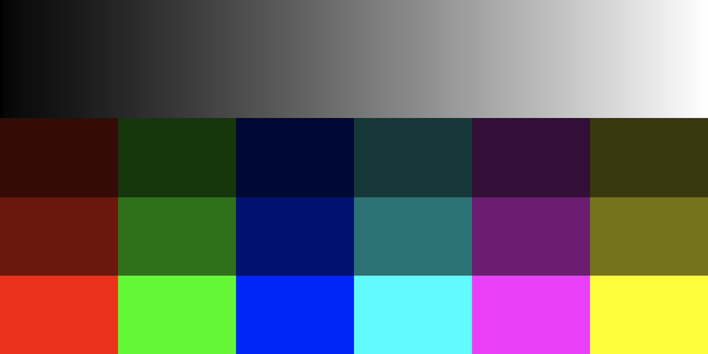
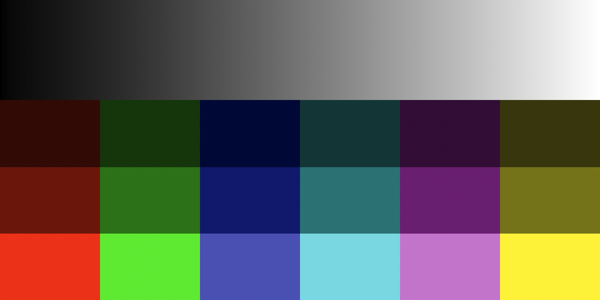

# DNG investigation: a reusable denoised negative

Investigated on 2026-10-26, macOS 27.2 (26B118), Preview 11.0 (1147.1.10), Apple RAW decoder `8.dng`, LibRaw 0.22.3 (`cf02d66`). This directory is research only. It adds no export format, app dependency, denoise operation, or persistent cache.

**Decision following the clarified requirement:** use Lightroom's workflow as the design target: run an expensive enhancement once, persist the resulting image, and apply subsequent develop settings to it without rerunning inference. DNG is a plausible container for that intermediate. Matching the final Ceviche edit in macOS Preview is no longer the acceptance criterion for this operation. DNG remains absent from the export dialog and MCP export schema.

The earlier appearance experiment found that a rendered linear DNG can look close on an ordinary photograph, but the tested metadata combinations do not reproduce the developed image reliably in Preview, especially for saturated colors. That finding does not rule out the denoised-negative workflow.

The [denoise model comparison](DENOISE-MODELS.md) examines RawNIND, PMRID, TreeNet and other alternatives, including code/weight licenses and a local PMRID Core ML conversion and tile-timing test. Model quality and full-image enhancement speed have not been benchmarked.

**2026-10-27 follow-up:** the [supplied-sample evaluation](../denoise-evaluation/README.md) adds real-image comparisons, Bayer processing and complete-frame inference timings. The clarified implementation direction starts enhancement from Bayer sensor data. It also verifies that ImageIO selects the original mosaic by default in the new Lightroom enhanced DNG sample.

## What the supplied Lightroom files actually contain

These are observations of the supplied files, not a claim that every Lightroom release writes the same layout. The originals were read without modification. Compact tag dumps are retained in [results/lightroom-panorama.json](results/lightroom-panorama.json) and [results/lightroom-denoise.json](results/lightroom-denoise.json).

| Property | `DSC09643-Pano.dng` | `DSC00023-Enhanced-NR.dng` |
| --- | --- | --- |
| DNG version / backward version | 1.7 / 1.7 | 1.7 / 1.3 |
| Main image | 17,092 × 5,609, three-channel LinearRaw | 8,000 × 5,320, one-channel RGGB mosaic |
| Main stored precision | 16-bit unsigned RGB; white 65,535 | 16-bit unsigned containers; black 512, white 16,383 (14-bit nominal white level) |
| Main compression | JPEG XL, TIFF compression 52546 | Lossless JPEG, TIFF compression 7 |
| Enhanced image | No separate enhanced IFD | Separate `NewSubfileType=16` IFD: 8,000 × 5,320, three-channel 16-bit LinearRaw, JPEG XL |
| Other images | JPEG thumbnail; RGB and linear previews; transparency masks | RGB thumbnail; JPEG preview; several linear previews |
| Color interpretation | Sony calibration, as-shot white balance, Adobe Standard profile and lookup tables | Sony calibration, as-shot white balance, Adobe Standard profile and lookup tables |
| Develop metadata | `HasSettings=False`, `AlreadyApplied=False` | `HasSettings=True`, `AlreadyApplied=False`; exposure +0.61, highlights −68, shadows +72, etc. |

Neither file supplies `ColorimetricReference=1`; the DNG default is scene-referred. The panorama has already been demosaiced and stitched, but still carries a camera-color interpretation. It is not simply a finished sRGB image in a DNG wrapper. The denoise file is particularly useful: it retains a mosaic image and stores a separate enhanced linear image, with develop settings still separate. Retaining that mosaic does not establish that it is byte-for-byte identical to the original ARW; that source was not supplied for comparison.

The JPEG XL image IFDs record nonzero `JXLDistance` values (0.1 for the panorama main image; 0.01 for the enhanced denoise image). Do not assume that “16-bit” means mathematically lossless compression. These are encoder-setting tags; we did not independently validate the JXL codestream's losslessness. Ceviche can choose lossless storage independently of Lightroom's choice.

LibRaw identifies both files. With `LIBRAW_RAWOPTIONS_DNG_ADD_ENHANCED`, it enumerates the denoise file's two source frames. Its native decoder successfully unpacks the Bayer frame. The locally built LibRaw and official macOS binaries do **not** include the Adobe DNG SDK integration: the panorama and enhanced JXL frames identify as `jxl_dng_load_raw_placeholder()` and cannot be unpacked in that build. This is a decoder-build limitation, not evidence that the files are invalid. [LibRaw documents DNG SDK 1.7 integration for JPEG XL DNG decoding](https://www.libraw.org/download). The prototype's uncompressed RGB DNG successfully unpacks through LibRaw into a 16-bit RGBX buffer.

## What this means for Ceviche's denoise workflow

The intended graph is:

```text
immutable original → defined input preparation → expensive denoise once
                                               ↓
                                  persistent enhanced image
                                               ↓
                         interactive develop settings → preview / export
```

The performance benefit comes from materializing the denoise output and reusing it. DNG alone does not make the model faster. The intermediate must sit before the edits expected to remain interactive, and preview tiles or a decoded image should be reused rather than decoding a huge DNG from disk for every slider event.

Current code differs from that design:

- [`RawRenderer+Export.swift`](https://github.com/ChiChou/Ceviche/blob/32044f3bb73503329be17304ed11ee77fb4af1a2/app/Sources/CevicheCore/RawRenderer+Export.swift), `exportImage`, runs AI denoise **after** the edit graph, cropping/resizing and HDR rendition. Export previews use that graph too. Develop previews currently have no AI denoise step.
- [`AIDenoise.swift`](https://github.com/ChiChou/Ceviche/blob/32044f3bb73503329be17304ed11ee77fb4af1a2/app/Sources/CevicheCore/AIDenoise.swift) uses NAFNet-SIDD, trained on gamma-encoded sRGB. The wrapper converts linear working RGB into the network's domain and adds its correction back. This is not a Bayer denoiser or a camera-linear RGB model.
- [`RawRenderer.swift`](https://github.com/ChiChou/Ceviche/blob/32044f3bb73503329be17304ed11ee77fb4af1a2/app/Sources/CevicheCore/RawRenderer.swift) currently applies white balance, exposure, Apple's tone response and conventional noise reduction in `CIRAWFilter` before the later edit graph. It caches the last complete preview, not an enhanced source.

A production implementation should therefore:

1. Introduce a distinct one-time Enhance/Denoise operation and an enhanced-source association. Preserve the original. A separate DNG derivative can satisfy the workflow without immediately duplicating every source and enhanced IFD that Lightroom uses.
2. Define and version the denoiser's input domain. With the current model, choose a stable decode/white-balance/color preparation, and explicitly represent which transforms have already been applied. A cache made from arbitrary current edits would become stale when any upstream edit changed. Achieving Lightroom-style camera-space semantics would require a suitable processing/model path; writing camera tags onto sRGB pixels would be incorrect.
3. Store correctly described linear image data at source resolution, before crop, rotation, resize, sharpening, local edits and final output tone mapping. Use lossless storage for the generated sample values. The current pipeline permits negative wide-gamut channels and values above SDR white: the experiment's bounded 16-bit linear sRGB files are **not** a production cache format for that range. Validate float storage/range handling and color interpretation before selecting a final DNG representation.
4. Key the enhanced result by source content identity, decoder/input-preparation version, model identity, and inference parameters. Ordinary downstream edits must not enter that key. Source replacement or changed inference inputs requires regeneration. If strength is only a blend against a fixed full-strength result, strength can be changed without rerunning the model; inference-affecting parameters cannot.
5. Persist atomically, record a source relationship and processing manifest, support cancellation/failure without replacing the source, and restore the enhanced source on reopening. Keep the inference node out of subsequent preview/export graphs, including export size changes. Avoid applying export AI denoise a second time by accident.
6. Preserve existing edits as editable settings and verify that enhancement does not apply them twice. Confirm stable geometry/mask coordinates, HDR and wide-gamut range, correct white-balance behavior, one inference per enhancement, no inference on later slider moves/reopen/export, and safe cache invalidation. Benchmark both initial processing and subsequent editing; the isolated PMRID tile timing does not measure this end-to-end workflow.

This establishes the workflow direction, not a finished denoising feature. The choice of model/input domain and a range-preserving DNG round trip are the remaining implementation decisions. The original mosaic and a denoised RGB image are different kinds of data; matching their nominal bit depth does not make the RGB image an unchanged sensor capture.

## Earlier Preview appearance experiment

The isolated writer stores uncompressed, unsigned 16-bit, three-channel `PhotometricInterpretation=34892` data. It converts a developed TIFF into linear sRGB rather than mislabeling gamma-encoded pixels. There is **no embedded preview**: Preview cannot hide a different RAW rendering behind an embedded JPEG.

Inputs were a grayscale/saturated-color chart, a Ceviche default render of `DSC00411.ARW` at 1,200 × 800, and an edited render with exposure/contrast/highlight/shadow/vibrance changes, quarter-turn rotation and a fixed crop at 720 × 960. All were SDR sRGB. Conversion to 16-bit linear TIFF alone changed at most one 8-bit comparison code value, so the large DNG differences are not explained by that quantization.

Five metadata variants were tested for every input:

| Variant | Interpretation |
| --- | --- |
| `scene-default` | Scene-referred, D65 color matrix and D50 forward matrix, no neutral tone tags |
| `scene-neutral` | Same, with identity `ProfileToneCurve`, `DefaultBlackRender=1`, zero baseline exposure/offset |
| `output-neutral` | Output-referred (`ColorimetricReference=1`), D50 matrices and PCS white point, same neutral tags |
| `output-no-forward` | Output-referred without a forward matrix |
| `output-icc` | Output-referred with an additional linear sRGB `AsShotICCProfile` and identity pre-profile matrix |

Errors below compare color-managed sRGB RGB channels in 8-bit code-value units; they are not perceptual ΔE values or a statement about the stored precision. Full machine-readable results are in [results/metrics.json](results/metrics.json).

| Fixture | ImageIO MAE, no neutral tags | ImageIO MAE, output-neutral | Output-neutral 99th percentile / maximum error |
| --- | ---: | ---: | ---: |
| Chart | 25.73 | 8.72 | 119 / 119 |
| Default photograph | 23.62 | 0.93 | 3 / 63 |
| Edited photograph | 27.71 | 0.86 | 6 / 58 |

The ICC and no-forward variants produced identical ImageIO metrics to `output-neutral`. Neutral tone tags substantially improve the result, but do not eliminate Apple's rendering. In `CIRAWFilter`, turning off gamut mapping alone reduced chart MAE from 8.72 to 0.82; turning off boost alone only reduced it to 8.57. A more neutral decode with boost, gamut mapping, local tone mapping, sharpening/detail and noise reduction disabled reached 0.44. These overrides are controls Ceviche can make in its own decoder; this experiment found no tested DNG metadata equivalent that made Preview use those settings. Even the neutral decode was not pixel-identical.

Actual Preview windows were captured for the output-neutral chart and edited photograph, alongside their TIFF references. Window-only screen capture was already authorized; accessibility automation was unavailable. Captures used identical window/image dimensions at 2× display backing scale. The generated images occupied their full native pixel dimensions in points; no source-photo full-resolution or multi-OS compatibility claim is made. Screenshot comparison includes display-profile conversion and scaling, so its numbers are separate from decoder metrics.

Actual Preview screenshot MAE was **8.52 for the chart** (maximum 117) and **0.91 for the edited photograph** (99th percentile 6). The difference is visible in blue, cyan and magenta. [Screenshot metrics](results/preview-metrics.json) retain the sampled patch values.

TIFF reference in Preview:



Output-referred linear DNG in Preview:



These results establish a mismatch for the tested encodings on this OS, not that every possible DNG encoding must fail. They also do not establish how Preview chooses among a source mosaic, an enhanced IFD and previews in Lightroom's files. That selection needs its own test before relying on an enhanced-IFD layout for interoperability.

## Reproduce

From the repository root, with a local RAW for the reference renders:

```sh
bash experiments/linear-dng/run.sh /absolute/path/to/reference.ARW
python3 experiments/linear-dng/inspect_dng.py /absolute/path/to/sample.dng
```

The opt-in XCTest only generates developed reference TIFFs. Without its environment variables it skips. The standalone Swift helper and Python writer generate files under ignored `.build/linear-dng-research`; nothing is added to the shipping renderer. Files in `results/` are the recorded observations from the run above; rerunning writes fresh results in `.build`, without silently replacing the recorded evidence.

To reproduce LibRaw inspection, build [LibRaw 0.22.3](https://github.com/LibRaw/LibRaw/tree/0.22.3) separately (`make -f Makefile.dist -j4`), run `bin/raw-identify -v -w -u sample.dng`, and compile `libraw_probe.cpp` with its include path, static `lib/libraw.a` and `-lz`. The probe enumerates both source and enhanced frames and reports unpack success/failure. LibRaw is used only as a research tool here; its LGPL 2.1 option is documented upstream. No LibRaw, Adobe SDK or other new library is linked or packaged into Ceviche by this investigation.

For Preview, open the generated reference TIFF and corresponding DNG with `open -a Preview`. Use a permitted window-only capture method. `probe screen OUTPUT_DIRECTORY` measures the captures named in its source; its crop coordinates are specific to the captured window layout and must be checked on another display. The standalone helper is a research harness, not a robust end-user CLI or a DNG conformance validator.

Useful primary references: [Adobe DNG resources](https://www.adobe.com/support/downloads/dng/dng_sdk.html), [Adobe SDK definitions of LinearRaw and scene/output references](https://android.googlesource.com/platform/external/dng_sdk/+/refs/heads/main/source/dng_tag_values.h), [Apple DNG properties](https://developer.apple.com/documentation/imageio/dng-image-properties), [Apple CIRAWFilter](https://developer.apple.com/documentation/coreimage/cirawfilter), and [LibRaw's buffer representation](https://www.libraw.org/docs/API-notes.html).
